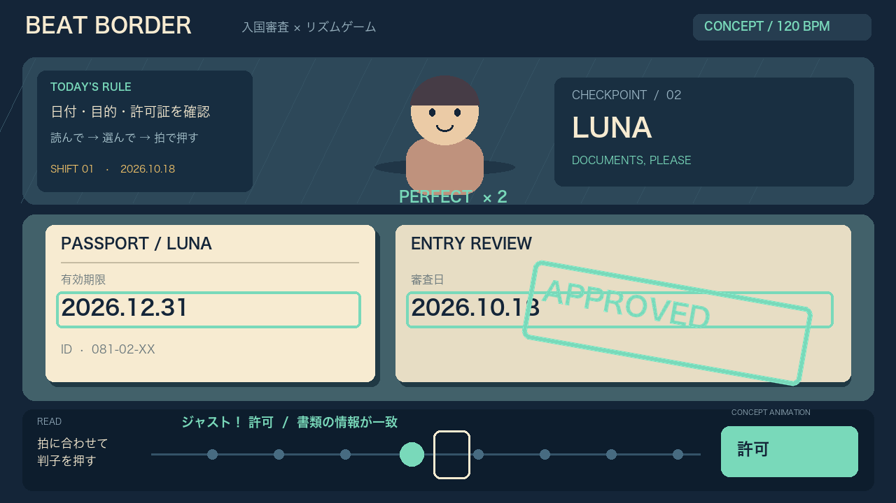

<<<<<<< HEAD
# DevDay Community Hackathon — BEAT BORDER / MIMIC

新しい試作 **BEAT BORDER**：データの中身を読み、拍に合わせて「許可・拒否・保留」を押す30秒のリズム検査ゲーム。

- **[BEAT BORDERを遊ぶ](https://mimic-octopus-1018.morita-shibu5.chatgpt.site/beat-border/)**
- [試作のソース・起動・検証](beat-border/README.md)

個人情報は拒否、中身が読めなければ保留、それ以外は許可。途中の通達で .exe も拒否になります。現在の試作は固定ルールで動作し、Decisions API / Sites MCP はまだ接続していません。

既存のMIMICは、色・形・リズムを合わせて90秒生き残る3D擬態ゲームです。

- [公開ゲーム](https://mimic-octopus-1018.morita-shibu5.chatgpt.site)
- [DevDay新機能の活用とデモ説明](https://mimic-octopus-1018.morita-shibu5.chatgpt.site/devday.html)
- [実装・起動・検証記録](mimic-octopus/README.md)
- [イベントルール](https://luma.com/OpenAIDevDay2026CommunityHackathonTokyo)

## 今回使う新機能

DevDay 2026のWebsite annotationsで、その瞬間のゲーム状態をChatGPTへの攻略相談に添付します。周期・位相差まで記録できるため、画像だけでは説明しにくいリズムのずれを伝えられます。
ゲーム本体の判定は固定ロジックです。ゲーム内でAIモデルを動かしているという主張はしません。

## 参加条件の確認事項

午前に公開した初版をベースにしています。事前プロトタイプの未公開条件との整合は主催者への確認が必要です。


## BEAT BORDER — 音ゲー × 入国審査のコンセプト

書類を読み、許可・拒否・追加検査を選び、拍に合わせて判子を押すゲーム案です。
16秒・120 BPM・音付きのモック動画を作りました。

[](media/beat-border-concept.mp4)

[動画ファイルを開く・ダウンロード](media/beat-border-concept.mp4)

この映像は実装前のコンセプトアニメーションです。Sites MCPによる管制操作、Decisions APIによる追加検査は今後の構想であり、この動画では接続していません。
=======
# DevDay-Community-Hackathon

## アイデア

脆弱性（サイバーセキュリティ）×ゲーム ＝教育

## PATCH / PANIC — 120秒の防衛線

[公開モックを遊ぶ](https://devday-papers-please.eightman.chatgpt.site/)

サービスへの攻撃を見つけ、応急遮断か根本修正を選ぶ120秒のブラウザゲームです。
Mini Metroの簡素なマップ、Papers, Pleaseの異常発見、Into the Breachの被害予告を組み合わせたモックです。

### ゲームの流れ

- **0:00** 入口・認証・データの3つでサービス開始。
- **0:25** 共有機能が追加され、不審な通信が発生。
- **0:50** 認証にも異常が発生。即時遮断か12秒の根本修正を判断。
- **1:20** 同じ弱点に再攻撃。応急遮断だけなら再発し、根本修正済みなら防壁で止まります。
- **2:00** 守れたデータ、判断履歴、関連する実在CVEを報告書で振り返ります。

### 状況ボード

- 緑：正常な通信
- 黄の点線：次に攻撃が進むマス
- 赤：データに向かって広がる攻撃
- 青：根本修正で作った防壁。再攻撃もここで止まります

経路のマス、または認証・共有のラベルをクリックすると調査できます。
応急遮断は今の赤い侵食を消しますが、抜け道が残ります。遮断後に根本修正することもできます。

### ローカル起動

ビルドやnpm依存はありません。Python 3があれば次で起動できます。

```sh
python3 -m http.server 8765 --bind 127.0.0.1
```

ブラウザで `http://127.0.0.1:8765/` を開いてください。

`index.html`、`style.css`、`game.js` で構成されています。
フォントはGoogle Fontsから読み込み、取得できない場合はシステムフォントで表示します。

### 検証と範囲

JavaScript構文、応急遮断後の再発、根本修正後の防御、放置時の流出、終了画面、侵食・予告・防壁表示、リセットを検証しました。
デスクトップのブラウザで開始・調査・防壁表示を確認しています。スマートフォン実機と難易度バランスの評価は未実施です。

ゲーム内の攻撃はブラウザ内のシミュレーションです。結果画面のCVEは関連する現実の事例であり、個別の攻撃手順を再現するものではありません。
>>>>>>> origin/master
