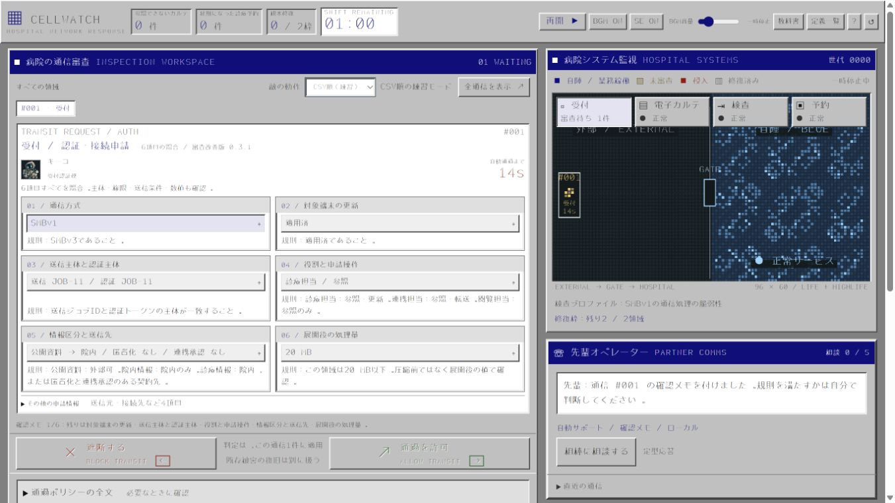
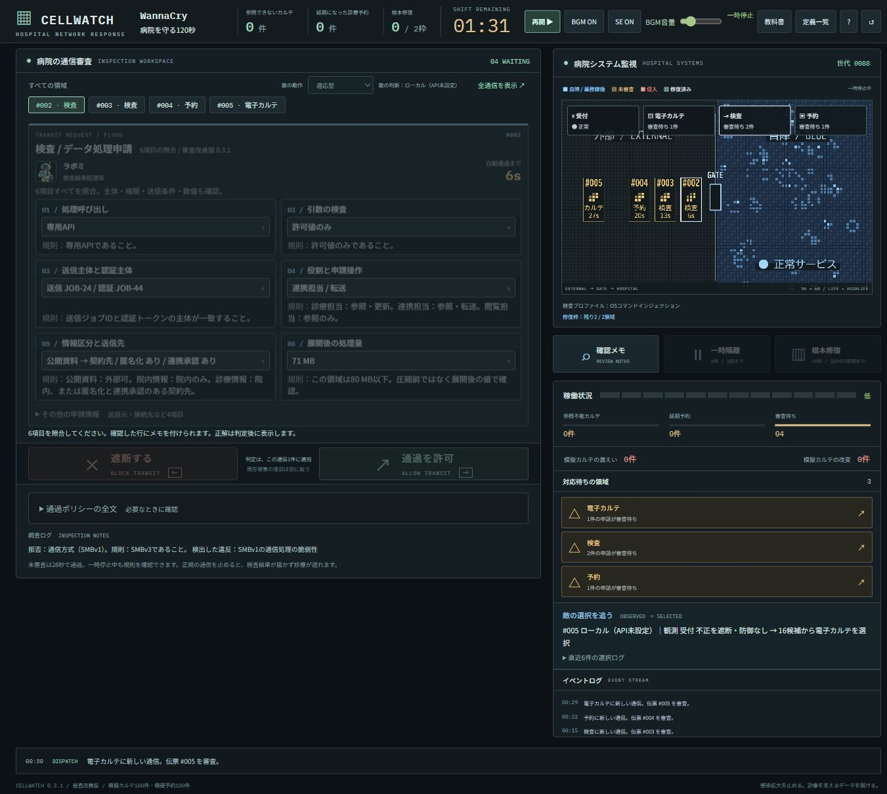
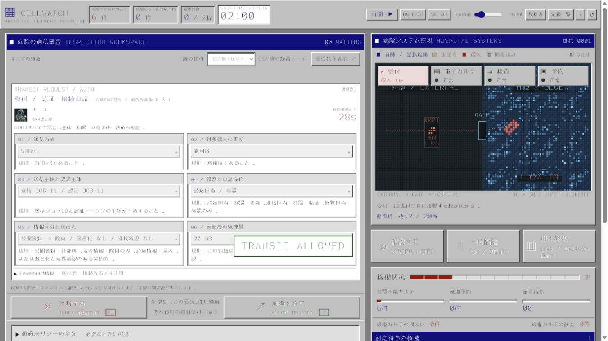
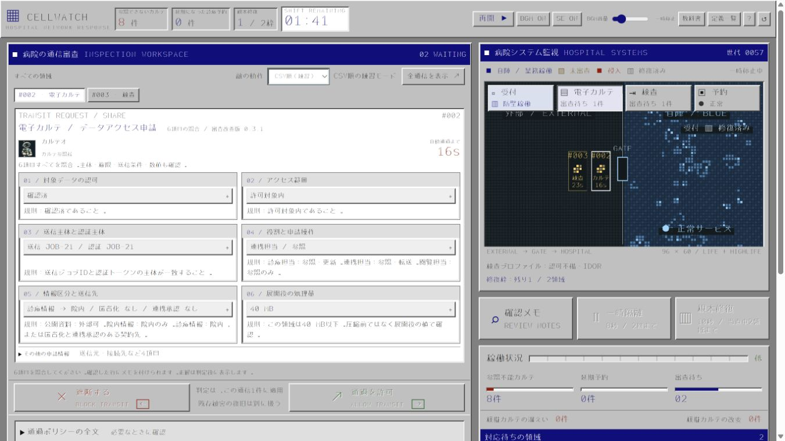

# CELLWATCH — 病院を守る60秒

**全部止めても、病院は守れない。6項目の証拠から通信の通過／遮断を判断する、60秒のブラウザゲームです。**

不正を通すとセルが自己複製し、模擬カルテに被害が広がります。正常通信を止めると、必要な検査結果が届かず診療予約が延期されます。プレイヤーが通過・遮断を選び、先輩が隔離・根本修復を自動支援しながら、自分の判断と防御状態を参照して選ばれる次の通信に対処します。

Decisions連携では、次の通信・投入間隔・戦術をまとめて選ぶ役割をモデルに委ねます。AI先輩は相談・終了時の振り返り・制約付きの自動支援を担当します。上流の[PR #20](https://github.com/eightman999/DevDay-Community-Hackathon/pull/20)では実API単発と公開版での動作確認が報告されています。この統合版ではモックとローカルで回帰検証しています。

[3分の操作手順](#3分で確かめる) · [最新版をローカルで起動](#起動) · [詳しい教科書](textbook.md) · [仕様](spec.md)

**確認対象は master の統合版 v0.3.1。** mainの6カード・時計なし演習・詳細教科書と、60秒化・AI先輩を統合しています。[ブランチ統合記録](docs/branch-integration.md)で元の変更と検証範囲を確認できます。

| 確認先 | 現在の状態 |
| --- | --- |
| [公開デモ](https://cellwatch-inspection.eightman.chatgpt.site/) | 公開担当はEightman。このmaster統合版の公開反映・確認は別途必要です。 |
| 最新版の操作 | Node.js 24.17.0で `npm run dev` → [localhost:8766](http://localhost:8766/)。取得からの手順は[起動](#起動)へ。アカウント・APIキー不要。 |
| AI連携 | Decisionsが敵の選択、Agentsが先輩の相談・振り返り・防御支援。掲載画像はローカル動作です。 |

**作品の核:** 6つの証拠を読む → 誤許可した不正通信と同じIDが病院へ侵入する → 増殖を止めても、既に失ったカルテは戻らない。通信の審査・セルの自己複製・病院業務の損失が、一つの判断でつながります。

<details>
<summary>審査画面の全体像：6カードを2列×3段で同時表示</summary>



</details>

## このゲームで起きること

- **名前や単語の一致だけでは決められない。** 技術所見2項目に加え、主体・権限・情報の送信条件・展開後の容量を照合します。6カードは同時に表示し、確認チェックを押しても正解は出ません。
- **守る行動にも選択がある。** 遮断は通信1件、隔離は8秒の猶予と予約4件の延期、根本修復は10秒で恒久対策。ただし修復できるのは全4領域中2領域まで。残りを審査で守る必要があります。
- **判断の結果が盤面に残る。** 誤許可した申請と同じIDの通信が病院へ入り、HighLifeの規則で複製します。修復で増殖を止めても、既に起きた被害は戻りません。
- **次に来る相手も固定ではない。** 適応型は直近の許可・遮断と防御状態を参照して出題します。顔は正解テンプレートと別に割り当て、同じ配達員が正常・不正の両方を運びます。

「楽しく遊んでいたら、いつの間にかセキュリティに詳しくなる」を目指し、短い当直の緊張感と再挑戦を知識の入口にします。効果測定の実績を主張するものではありません。

例えば、技術所見・主体・権限・容量がすべて正常でも、次の2件では判断が変わります。

| 情報と送信先 | 匿名化 | 連携承認 | 判断 |
| --- | --- | --- | --- |
| 診療情報 → 契約先 | あり | なし | 遮断 |
| 診療情報 → 契約先 | あり | あり | 通過 |

セキュリティに関心のある開発者・学生が、勉強会や短いデモで「不正を止める」と「業務を止めない」の両方を試せる作品です。最初は時計なしで1件ずつ試し、慣れたら60秒の当直へ挑戦できます。

## Decisionsで何を選ぶのか

**実行時の選択と採点を分離しています。** Decisions APIへ直近の判断と4領域の防御状態を渡し、次の模擬通信・投入間隔・戦術を選ぶ接続を実装しています。採点は共通規則で固定するため、モデルの選択で正解が揺れることはありません。

| 出題方法 | 通信の選び方 | 投入間隔・戦術 |
| --- | --- | --- |
| CSV順（練習） | 固定順序 | 3.5秒間隔 |
| ローカル適応型 | 履歴・防御状態・seedに基づく固定の重み付け | 3.5秒間隔、ローカル選択 |
| Decisions連携 | 同じ観測から、通信ID・間隔・戦術をまとめた候補をモデルが1件選択 | 2／3.5／5秒、転進・陽動・集中 |

転進は直前と異なる不正経路、陽動は正常通信、集中は見逃された不正経路を候補にします。**戦術の意味・合法な候補の生成・採点はコードの固定規則で、モデルはその組み合わせから `choice` を選びます。** 修復済み経路の不正通信は候補から除外します。選択間隔は終盤の残件数に合わせて調整される場合があります。

履歴への応答はローカル版にもあります。Decisionsで加えるのは、通信だけでなく投入の速さと戦術を同時に選ぶ役割です。遊びやすさ・選択品質がローカル版より向上するかは未測定です。

画面の **「敵の選択を追う」** で、実際に観測した判断・防御状態 → 候補数 → 選択元と選択領域を確認できます。先読みしたAPI回答を使った場合と、ローカルで再計算した場合を区別します。これは入力と選択結果の記録で、モデルの推論理由を後付けした文章ではありません。

| 実行時の新機能連携 | 作品での役割 | 実装・記録 |
| --- | --- | --- |
| Decisions API / `choice` | 判断履歴と防御状態に応じた、通信・投入間隔・戦術の選択 | [共通サービス](server/decision-service.mjs)、[先読みと観測記録](dist/enemy.mjs)、[公式仕様](https://developers.openai.com/api/docs/guides/decisions) |

制作素材として、GPT Imageで生成した[16人の配達員](dist/assets/characters/)と[生成プロンプト](artifacts/hospital-character-prompts.json)、既存の[PC98風日本語フォントとその出典・ライセンス](dist/assets/fonts/README.md)も同梱しています。これらの素材は、ゲーム実行中のDecisions連携とは別です。記録で確認できない制作ツールやモデルの版を、新機能の実績には含めません。

| 証拠の範囲 | 確認したこと |
| --- | --- |
| 自動テスト・ローカルHTTP | 候補の制約、モック回答の通信・間隔・戦術の反映、不正回答・失敗時の切替 |
| 掲載実画面・出題実測 | ローカル適応型の動作、審査から侵入・修復への因果 |
| 上流PRの報告 | [PR #20](https://github.com/eightman999/DevDay-Community-Hackathon/pull/20)で実Decisions・Agentsの単発成功とSites上の動作を確認。統合版の実API性能・公開版の同一性は今回の検証外 |

キー未設定・失敗・期限超過時はローカル適応型へ切り替え、画面に実際の選択元を表示します。Sites Worker版は同一オリジンのAPI経路を持ち、AI有効化とChatGPTログインで利用する構成です。`dist/`のみの静的公開ではローカル適応型が動きます。

<details>
<summary>観測と選択が分かる実画面（API未設定時のローカル適応）</summary>



</details>

## 先輩オペレーター

通過・遮断はプレイヤーが決め、先輩は確認メモ・一時隔離・根本修復を自動支援します。防御の候補と実行時の両方で、隔離2回・修復2領域・同時修復1領域の制約を守ります。相談は当直中5回、自動支援のAPI選択は6回まで。APIが使えないときはローカルの先輩が続けます。時計なし演習では自動支援とAI相談を停止し、手動で証拠を照合します。

Agentsに送るのは判定前の正解を除いた観測です。判定後の理由は共通規則から取得し、画面はAIと定型応答を区別します。[支援の共通規則](dist/companion-context.mjs)・[実行時の再検証](dist/companion-support.mjs)・[サーバー](server/companion-service.mjs)を参照してください。

## 3分で確かめる

**対象:** 上記の最新版をローカルで開き、リセットした状態から始めます。APIキーがない場合はローカル適応型の実演になります。途中で読み切れないときは一時停止してください。

| 時間 | 操作 | 見どころ |
| --- | --- | --- |
| 0:00–0:30 | 「まず1件、時計なしで試す」から、最初の受付申請を遮断。理由を読み、「次の演習へ」で正常な電子カルテ申請を通す | 6カードの照合と、判定後だけに表示される根拠 |
| 0:30–1:40 | リセットし「CSV順（練習）」で開始。最初の受付申請を比較用に通し、先輩の自動隔離・修復と通信欄を確認。必要なら一時停止して読む | 同じ申請IDの侵入、模擬被害、10秒後の防壁。増殖が止まっても累積被害は残る |
| 1:40–2:35 | リセットして「適応型」で開始し、開始直後に最初の通信を判定。次の通信が来たら一時停止し「敵の選択を追う」を確認 | 直近の判断・防御状態から何が選ばれ、API／ローカルのどちらが動いたか |
| 2:35–3:00 | 教科書の詳細ページで、冒頭の「連携承認あり／なし」と対処の違いを確認 | 条件次第で通信を通し、限られた修復で残りを守る。このゲームで判断することを振り返る |

当直を最後まで進めると、被害・手動審査・未審査通過・自動防御を報告書で振り返れます。終了時の教科書モーダルも残し、詳細解説は別ページで読めます。

[詳細教科書ページの実画面](docs/images/textbook-detail.png)

### 実画面で見る判断の結果（統合前の120秒版）

**申請 #001 を誤許可 → 閲覧不能6件 → 受付を10秒かけて修復 → 増殖は止まり、累積8件の被害は残る。** 以下は統合前の120秒版をCSV順・ローカルで実行した記録です。統合後は60秒・自動支援となり、同じ被害件数を保証しません。



受付の修復完了後は侵入を除去。修復までに増えた累積8件は回復せず残ります。いずれもローカル実行の画面です。



## 起動

**Windows / Node.js 24.17.0で確認**。追加パッケージのインストールやビルド、アカウント、APIキーは不要です。

```powershell
git clone --branch master https://github.com/eightman999/DevDay-Community-Hackathon.git
cd DevDay-Community-Hackathon
npm run dev
```

[localhost:8766](http://localhost:8766/)を開きます。初期値は適応型。開始前に「CSV順（練習）」「時計なし演習」も選べます。モード変更はリセット後に行います。

別ポートを使う場合:

```powershell
$env:CELLWATCH_PORT = '8767'
npm run dev
```

任意でDecisions・Agentsを使う場合は[`.env.example`](.env.example)を参考に、Git対象外の`.env`へ`OPENAI_API_KEY`を設定して再起動します。キーはサーバーだけが読みます。`CELLWATCH_ENEMY_MODE=auto`はキーがあればAPI、`local`は常にローカルです。

公式の`POST /v1/decisions`・`gpt-6-luna`・`choice`に対応。初手はローカル、以後は到着4秒前から先読みします。最大15回／当直、プロセス／Workerインスタンスごとに最大64回。サーバー期限3.2秒、ブラウザHTTP期限3.6秒、director期限3.8秒、再試行なし。API待ちでゲームを止めません。

Sites向けの[Workerアプリ](sites/README.md)も同梱しています。依存準備後の`npm run build`で配信用成果物を生成し、ゲーム画面とAPIを同じオリジンで配信します。AIのキーはWorkerのsecretに置き、`ENEMY_AI_ENABLED=true`で有効化。ルートのローカルゲームにはこのビルドは不要です。公開反映はEightman側で行います。

## 動作の証拠

```powershell
npm run check
npm test
node scripts/verify-demo.mjs
```

- 構文検査と **132件の自動テスト** が成功。統合版のブラウザ確認と、統合前の全16申請の表示確認は[検証記録](docs/validation.md)で区別しています。
- seed 1〜128、各16件を検証。旧番号攻略botは正答 **55.47%**、6項目の公開規則を読む検証用botは **100%・被害0**。全16配達員が正常・不正の両方を運びました。
- 手動審査をせず修復だけを行う既知の方策も検証し、2枠制限後は **被害ゼロ完走0/128**。順序は受付→電子カルテで、全戦略を網羅した主張ではありません。

条件・結果・ソースハッシュは[実測JSON](docs/evidence/review-metrics.json)、ブラウザ・APIモック・回帰の範囲は[検証記録](docs/validation.md)に掲載しています。同じseedでも判断履歴により後続出題は変わります。botの成績は人間の学習効果や実APIの品質を測定したものではありません。

## 一次審査の確認先

[大会公式](https://luma.com/OpenAIDevDay2026CommunityHackathonTokyo)の4観点に沿った入口です。実際の配点・採点プロンプトは非公開です。

| 観点 | 確認できること | 根拠 |
| --- | --- | --- |
| 新機能の活用 | AIへ通信・間隔・戦術の選択を委ねる連携を実装（上流の単発確認と今回の回帰検証を区別）。採点と分離し、観測と選択元を追跡 | [Decisions連携](server/decision-service.mjs)、[敵の制御](dist/enemy.mjs) |
| 使いやすさ | 2列×3カード、時計なしの入口、判定後の理由、別ページの詳細教科書 | [画面](docs/images/cellwatch-review.png)、[検証](docs/validation.md) |
| 有用性 | 正常通信を止める代償と、単発遮断・一時隔離・限られた恒久対策を比較 | [対処と被害](dist/engine.mjs)、[教科書](textbook.md) |
| 独創性 | 複数条件の通信審査、実際に複製するセル、判断を参照する出題が一つの盤面につながる | [共通規則](dist/threats.mjs)、[HighLife](dist/automata.mjs)、[出題実測](docs/evidence/review-metrics.json) |

## 範囲と構成

2017年のWannaCryによるNHSへの影響を背景にした仮想ゲームです。WannaCry関連はSMBの例のみで、他10種類は仮想例。模擬カルテ・予約各100件を扱い、実攻撃・患者データ・実運用の安全判定は扱いません。HighLifeは実際の隣接規則で更新し、被害件数は別のゲーム係数で計算します。状態はメモリ内で、リセット・再読み込みで消えます。

[仕様](spec.md) · [教科書と一次資料](textbook.md) · [CSV編集手順](dist/data/README.md) · [既存Sites設定](.openai/hosting.json)

## 別案・参考素材

CELLWATCHをルートの作品として維持し、他ブランチの別案も次のディレクトリに保存しています。

- [MIMIC](mimic-octopus/README.md) / [BEAT BORDER](beat-border/README.md)
- [ON CALL](oncall-0317/README.md)
- [BGM参考素材](references/2026-10-18/audio/README.md) / [3D参考素材](references/2026-10-18/3d/README.md)
- [置き換え済みのDots審査案の差分](docs/archive/dots-review.patch)

## 発表用イントロ動画

ゲーム本体でもページを開くと`cellwatch-intro-v6.mp4`の30秒イントロを消音で自動再生します。「音声をオン」で音付きに切り替えられます。終了・スキップ・Escapeで開始待ち画面に進み、「当直開始」を押すまで時計は進みません。自動再生が制限された場合は動画内の再生ボタンを使い、読み込み失敗時もスキップできます。元動画は`presentation/`、静的配信用の同一動画は`dist/assets/video/`に置きます。

30秒の動画と、終了後に実ページへ自動で切り替わる[発表ページ](presentation/README.md)を同梱しています。[発表セットZIP](presentation/cellwatch-presentation.zip)も利用できます。

制作クレジット: BGM『TACTICAL BREACH : OVERDRIVE』はChatGPT 6 Proと6.1solによる制作。日本語フォントの字形はDotsによる制作で、同梱版の出典とライセンスは[フォント資料](dist/assets/fonts/README.md)を参照してください。
