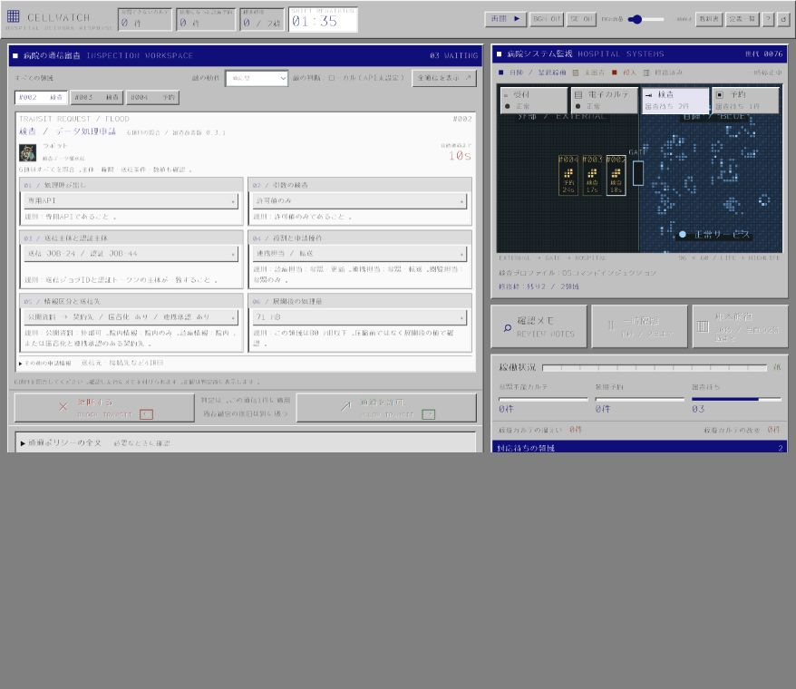

# CELLWATCH — 病院を守る120秒

**全部止めても、病院は守れない。6項目の証拠から通信の通過／遮断を判断する、120秒のブラウザゲームです。**

不正を通すとセルが自己複製し、模擬カルテに被害が広がります。正常通信を止めると、必要な検査結果が届かず診療予約が延期されます。遮断・隔離・根本修復を使い分けながら、自分の判断と防御状態を参照して選ばれる次の通信に対処します。

[公開デモ](https://cellwatch-inspection.eightman.chatgpt.site/) · [詳しい教科書](textbook.md) · [仕様](spec.md)

> このPRは **v0.3.1**。既存の公開デモは旧版で、最新版の公開反映はEightman側が担当します。以下の画像・検証記録はこのPRの実装を対象にしています。



## このゲームで起きること

- **名前や単語の一致だけでは決められない。** 技術所見2項目に加え、主体・権限・情報の送信条件・展開後の容量を照合します。6カードは同時に表示し、確認チェックを押しても正解は出ません。
- **守る行動にも選択がある。** 遮断は通信1件、隔離は8秒の猶予と予約4件の延期、根本修復は10秒で恒久対策。ただし修復できるのは全4領域中2領域まで。残りを審査で守る必要があります。
- **判断の結果が盤面に残る。** 誤許可した申請と同じIDの通信が病院へ入り、HighLifeの規則で複製します。修復で増殖を止めても、既に起きた被害は戻りません。
- **次に来る相手も固定ではない。** 適応型は直近の許可・遮断と防御状態を参照して出題します。顔は正解テンプレートと別に割り当て、同じ配達員が正常・不正の両方を運びます。

例えば、技術所見・主体・権限・容量がすべて正常でも、次の2件では判断が変わります。

| 情報と送信先 | 匿名化 | 連携承認 | 判断 |
| --- | --- | --- | --- |
| 診療情報 → 契約先 | あり | なし | 遮断 |
| 診療情報 → 契約先 | あり | あり | 通過 |

セキュリティに関心のある開発者・学生が、勉強会や短いデモで「不正を止める」と「業務を止めない」の両方を試せる作品です。最初は時計なしで1件ずつ試し、慣れたら120秒の当直へ挑戦できます。

## DevDayの新機能を何に使ったか

**Decisions APIを、プレイヤーの判断に応答する出題役として組み込みました。** 直近の判断と4領域の防御状態を渡し、次の模擬通信を既知の候補から1件選びます。採点は共通規則で固定するため、AIの回答で正解が揺れることはありません。

選ぶのは通信だけでなく、**次の投入間隔（4／7／10秒）と、転進・陽動・集中の戦術を組み合わせた次の一手**です。対処された経路を避けるか、正常通信で陽動するか、通された経路へ集中するかを、制約付きの`choice`にします。

狙いは、問題の順番を覚えるゲームから、自分の直前の対応を踏まえて次の証拠を読むゲームへ変えることです。

画面の **「敵の選択を追う」** で、実際に観測した判断・防御状態 → 候補数 → 選択元と選択領域を確認できます。先読みしたAPI回答を使った場合と、ローカルで再計算した場合を区別します。これは入力と選択結果の記録で、モデルの推論理由を後付けした文章ではありません。

| 使用機能 | 作品での役割 | 実装・記録 |
| --- | --- | --- |
| Decisions API / `choice` | 判断履歴と防御状態に応じた、通信・投入間隔・戦術の選択 | [共通サービス](server/decision-service.mjs)、[先読みと観測記録](dist/enemy.mjs)、[公式仕様](https://developers.openai.com/api/docs/guides/decisions) |
| GPT Image | 通信を16人の配達員として描き、抽象的なデータの出入りをゲームの相手にする | [画像](dist/assets/characters/)、[生成プロンプト](artifacts/hospital-character-prompts.json) |
| Dotsで制作した日本語フォント | PC98風の文字を、レトロな審査端末と盤面ラベルで共用 | [取得版・対応ソース・ライセンス](dist/assets/fonts/README.md) |

Decisionsの接続経路はモックとローカルHTTPで確認しました。**実APIの課金呼出は未実施**です。キー未設定・失敗・期限超過時はローカル適応型へ切り替え、画面に実際の選択元を表示します。Sites Worker版は同一オリジンのAPI経路を持ち、AI有効化とChatGPTログインで利用する構成です。`dist/`のみの静的公開ではローカル適応型が動きます。

<details>
<summary>観測と選択が分かる実画面（API未設定時のローカル適応）</summary>


</details>

## 3分で確かめる

| 時間 | 操作 | 見どころ |
| --- | --- | --- |
| 0:00–0:30 | 「まず1件、時計なしで試す」から、最初の受付申請を遮断。理由を読み、「次の演習へ」で正常な電子カルテ申請を通す | 6カードの照合と、判定後だけに表示される根拠 |
| 0:30–1:40 | リセットし「CSV順（練習）」で開始。最初の受付申請を比較用に通し、受付を根本修復。必要なら一時停止して読む | 同じ申請IDの侵入、模擬被害、10秒後の防壁。増殖が止まっても累積被害は残る |
| 1:40–2:35 | リセットして「適応型」で開始し、最初の通信を判定。次の通信が来たら一時停止し「敵の選択を追う」を確認 | 直近の判断・防御状態から何が選ばれ、API／ローカルのどちらが動いたか |
| 2:35–3:00 | 教科書の詳細ページで、冒頭の「連携承認あり／なし」と対処の違いを確認 | 条件次第で通信を通し、限られた修復で残りを守る。このゲームで判断することを振り返る |

当直を最後まで進めると、被害・手動審査・未審査通過・自動防御を報告書で振り返れます。終了時の教科書モーダルも残し、詳細解説は別ページで読めます。

[詳細教科書ページの実画面](docs/images/textbook-detail.png)

<details>
<summary>実画面で見る：誤許可 → 侵入 → 根本修復</summary>

CSV順の最初の申請 #001 を比較用に許可すると、模擬の閲覧不能が6件発生します。


受付の修復完了後は侵入を除去。修復までに増えた累積8件は回復せず残ります。いずれもローカル実行の画面です。


</details>

## 起動

**Windows / Node.js 24.17.0で確認**。追加パッケージのインストールやビルド、アカウント、APIキーは不要です。

```powershell
npm run dev
```

[localhost:8766](http://localhost:8766/)を開きます。初期値は適応型。開始前に「CSV順（練習）」「時計なし演習」も選べます。モード変更はリセット後に行います。

別ポートを使う場合:

```powershell
$env:CELLWATCH_PORT = '8767'
npm run dev
```

任意でDecisionsを使う場合は[`.env.example`](.env.example)を参考に、Git対象外の`.env`へ`OPENAI_API_KEY`を設定して再起動します。キーはサーバーだけが読みます。`CELLWATCH_ENEMY_MODE=auto`はキーがあればAPI、`local`は常にローカルです。

公式の`POST /v1/decisions`・`gpt-6-luna`・`choice`に対応。初手はローカル、以後は到着2秒前に先読みします。最大15回／当直、プロセス／Workerインスタンスごとに最大64回。サーバー期限1.2秒、ブラウザ期限1.6秒、再試行なし。API待ちでゲームを止めません。

Sites向けの[Workerアプリ](sites/README.md)も同梱しています。依存準備後の`npm run build`で配信用成果物を生成し、ゲーム画面とAPIを同じオリジンで配信します。AIのキーはWorkerのsecretに置き、`ENEMY_AI_ENABLED=true`で有効化。ルートのローカルゲームにはこのビルドは不要です。公開反映はEightman側で行います。

## 動作の証拠

```powershell
npm run check
npm test
node scripts/verify-demo.mjs
```

- 構文検査と **104件の自動テスト** が成功。実ブラウザで1366×768の全16申請について、6カードと判定ボタンがスクロールなしで表示されることを確認しました。
- seed 1〜128、各16件を検証。旧番号攻略botは正答 **55.47%**、6項目の公開規則を読む検証用botは **100%・被害0**。全16配達員が正常・不正の両方を運びました。
- 手動審査をせず修復だけを行う既知の方策も検証し、2枠制限後は **被害ゼロ完走0/128**。順序は受付→電子カルテで、全戦略を網羅した主張ではありません。

条件・結果・ソースハッシュは[実測JSON](docs/evidence/review-metrics.json)、ブラウザ・APIモック・回帰の範囲は[検証記録](docs/validation.md)に掲載しています。同じseedでも判断履歴により後続出題は変わります。botの成績は人間の学習効果や実APIの品質を測定したものではありません。

## 一次審査の確認先

[大会公式](https://luma.com/OpenAIDevDay2026CommunityHackathonTokyo)の4観点に沿った入口です。実際の配点・採点プロンプトは非公開です。

| 観点 | 確認できること | 根拠 |
| --- | --- | --- |
| 新機能の活用 | AIを通信・間隔・戦術の選択に使い、採点と分離。観測と実際の選択元を追跡 | [Decisions連携](server/decision-service.mjs)、[敵の制御](dist/enemy.mjs) |
| 使いやすさ | 2列×3カード、時計なしの入口、判定後の理由、別ページの詳細教科書 | [画面](docs/images/cellwatch-review.png)、[検証](docs/validation.md) |
| 有用性 | 正常通信を止める代償と、単発遮断・一時隔離・限られた恒久対策を比較 | [対処と被害](dist/engine.mjs)、[教科書](textbook.md) |
| 独創性 | 複数条件の通信審査、実際に複製するセル、判断を参照する出題が一つの盤面につながる | [共通規則](dist/threats.mjs)、[HighLife](dist/automata.mjs)、[出題実測](docs/evidence/review-metrics.json) |

## 範囲と構成

2017年のWannaCryによるNHSへの影響を背景にした仮想ゲームです。WannaCry関連はSMBの例のみで、他10種類は仮想例。模擬カルテ・予約各100件を扱い、実攻撃・患者データ・実運用の安全判定は扱いません。HighLifeは実際の隣接規則で更新し、被害件数は別のゲーム係数で計算します。状態はメモリ内で、リセット・再読み込みで消えます。

[仕様](spec.md) · [教科書と一次資料](textbook.md) · [CSV編集手順](dist/data/README.md) · [既存Sites設定](.openai/hosting.json)
