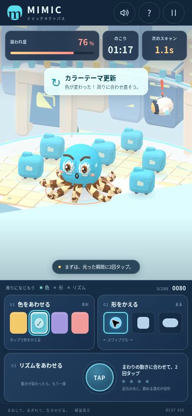

# MIMIC OCTOPUS — ミミックオクトパス

周りが変わったら、色・形・リズムを合わせよう。

正常なデータに紛れ込んだ、小さなミミックオクトパスの3Dブラウザゲームです。環境更新で周囲の姿や動きが変わるたびに、スマホで擬態を調整します。監視ドローンに見つからず、90秒間を生き残るのが目標です。

## 遊ぶ・続きを作る

- **遊べる版:** https://mimic-octopus-1018.morita-shibu5.chatgpt.site
- **GitHub:** [eightman999/DevDay-Community-Hackathon](https://github.com/eightman999/DevDay-Community-Hackathon) の `mimic-octopus/` フォルダ。
- **Codexへの引き継ぎ:** [開始手順とプロンプト](docs/CODEX-HANDOFF.md)

現在のSites公開範囲はpublicです。ゲーム自体にはログイン処理や推論APIはありません。GitHubへpushした変更を公開版へ反映するには、別途デプロイが必要です。

## 実際のプレイ画面



GPUが無効な検証ブラウザで撮影した、Canvas2Dによる軽量3D表示です。WebGL 2対応環境では同じ形状をGPUで描画します。軽量表示は面の陰影と透過が簡略化されます。

## 制作イメージ


上の画像はアートと遊びの方向を示すコンセプト画像です。実装画面のスクリーンショットではありません。実際のゲームでは、タコ・データ群・ドローンを3Dで描画し、操作に応じて動かします。

## 起動

Node.js 20以降を使用します。GitHubリポジトリを開いた場合は、まず `mimic-octopus/` に移動してください。静的ファイルを `dist/` から配信する、ビルド不要のES Modules構成です。初回の `npm install` で固定版のThree.js 0.180.0を取得し、必要な描画ファイルを `dist/vendor/` に用意します。ゲーム用のAPIキーは不要です。

```sh
npm install
npm run dev
```

表示されたURLをブラウザで開いてください。スマホから試す場合は、スマホから到達できるアドレスで配信します。公開された静的ホスティングを使う場合、公開対象は `dist/` です。

```sh
npm test
npm run check
```

| コマンド | 役割 |
| --- | --- |
| `npm run dev` / `npm start` | ローカルの静的開発サーバーを起動 |
| `npm test` | ゲームロジックのテストを実行 |
| `npm run check` | プロジェクトの静的チェックを実行 |

## 遊び方

1. 周囲の正常データの色・輪郭・動きを観察します。
2. 環境が更新されたら、変わった要素を合わせ直します。
3. スキャンが来るまでに擬態を整えます。周囲と違うままスキャンされると、疑われ度が上がります。
4. 90秒間を生き残れば成功。見つかった場合は結果を見て、もう一度挑戦します。

| 操作 | 内容 |
| --- | --- |
| 色 | 黄・青・紫・ピンクの4色からタップで選択 |
| 形 | 丸・四角・カプセルの3形態を、スワイプまたは画面の選択ボタンで切り替え |
| リズム | 周囲の拍に合わせて2回タップ。その間隔とタイミングで自動的に動き続ける |
| 一時停止 | プレイ中の時計と判定を止める |
| サウンド | 任意で有効化。音がなくても必要な情報が画面で分かる |

リズムは環境の拍が変わったときに覚え直します。色と形を直している間も、覚えた動きは続きます。精密な連打より、近くのデータを見て変化に気づくことを重視します。

## v0.1の範囲

スマホ1台で遊べるソロです。縦画面・横画面の両方で、タコ、監視、周囲の見本、3種類の操作にアクセスできます。

実装済みの内容は、90秒のプレイ、9段階の環境と9回のスキャン、4色・3形態・2タップのリズム学習、環境変更後の反応猶予、疑われ度、成功・失敗・再挑戦、一時停止、任意サウンド、端末内のベストスコア保存です。正確なタイミングと判定は [ENGINE.md](docs/ENGINE.md) を参照してください。

共通モニターと各自のスマホを接続する遊び、複数人のルーム、通信切断からの復帰は後続の開発範囲です。

## ファイル案内

| 場所 | 役割 |
| --- | --- |
| `dist/index.html`, `dist/styles.css`, `dist/js/app.js` | 画面、タッチ操作、ゲームと描画の接続 |
| `dist/js/engine.mjs` | 時間、環境更新、擬態の一致判定、勝敗 |
| `dist/js/scene.js` | Three.jsによる3D描画とアニメーション |
| `dist/js/software-renderer.js` | WebGLを利用できない環境向けの軽量3D描画 |
| `dist/vendor/` | 同梱する描画ライブラリ |
| `tests/engine.test.mjs` | ゲームルールの回帰テスト |
| `scripts/` | 開発サーバーとチェック |
| `docs/IMPLEMENTATION-CONTRACT.md` | エンジンと描画のAPI契約 |

開発時は [AGENTS.md](AGENTS.md)、[ゲーム仕様](docs/GAME-DESIGN.md)、[アート方針](docs/ART-DIRECTION.md)を参照してください。次の開発環境へ渡す手順と開始プロンプトは [CODEX-HANDOFF.md](docs/CODEX-HANDOFF.md) にあります。

## 確認状況

2026-10-18に確認。ブラウザ検証はクラウドChromeで実施し、スマホの画面寸法は実アプリをiframe内で390×844／844×390 CSS pxに配置して確認しました。物理スマホの試験を代替するものではありません。

| 項目 | 状態 | 確認内容 |
| --- | --- | --- |
| ゲームロジック | 15テスト通過 | 無操作で敗北、正しい操作で90秒・全9スキャンを通過、位相・テンポ、一時停止、長い／不規則なフレーム更新 |
| 静的チェック | 通過 | JavaScript構文、相対import、HTML内のローカル参照 |
| 縦・横の画面 | 確認済み | 390×844／844×390。操作部と3D、結果と再挑戦。横画面の結果を画面全体に表示するよう調整 |
| 軽量3D描画 | 確認済み | タコ・腕・群れ・都市・ドローン、丸／四角／カプセル、環境更新とスキャン |
| 操作と進行 | 確認済み | 色・形のクリック、形のドラッグ、2タップで一致・自動継続、疑われ度、敗北、再挑戦 |
| 一時停止とヘルプ | 確認済み | ヘルプ開閉を挟んでも01:27で時計が停止。再開後に進行 |
| サウンド | UI確認済み | オン切替とWeb Audio初期化。実際の音の聞こえ方・音量は未確認 |
| GPU描画・スマホ実機 | 未確認 | 検証用ChromeはGPUが無効。実際のSafari／Android ChromeでのGPUの見え方、指での操作、処理負荷は次の確認項目 |

依存ライブラリのライセンスは [THIRD-PARTY-NOTICES.md](THIRD-PARTY-NOTICES.md) に記載しています。


## DevDay 2026の新機能活用（今回の改修）

公式発表の **Website annotations / Browser Annotation API** を、実プレイの振り返りに利用します。
「相談」でゲームを停止し、色・形・周期・位相差・スキャン・不一致の累計を固定して、利用者の操作で注釈へ添付します。
スクリーンショットでは分からないタイミングの違いをChatGPTに伝え、攻略の相談に使えます。

- 実装: `dist/js/coaching.mjs` の `buildCoachingReport` と `installCoaching`。
- 公開説明: [DevDay活用](https://mimic-octopus-1018.morita-shibu5.chatgpt.site/devday.html)。発表用の説明文もあります。
- 公式発表: https://learn.chatgpt.com/docs/whats-new/devday-2026
- API仕様: https://learn.chatgpt.com/docs/annotations-extensibility
- 未実装: ゲーム内AI推論、AI監視役、AIステージ生成、MCP Events、ChatGPTログイン。
- 勝敗と既存ヒントは固定ルール。AIによる助言は利用者が送信した先のChatGPTで行います。
- API非対応ブラウザでは同じ相談記録をコピーできます。新機能の直接利用は対応デスクトップ内ブラウザに限られます。

今回の検証: Nodeで `npm test` と `npm run check` の実体を直接実行（この環境にはnpmが無い）。18/18テスト、静的チェック通過。
Codex内ブラウザの390×844と844×390で相談パネルを確認。プレイ3.2秒時点の記録、一時停止の維持、再開、スキャン後の不一致累計、コピー成功を確認。
注釈APIの存在は確認できましたが、ブラウザ制御中のrequestはaccepted=falseでした。拒否時の案内を確認済みです。利用者による注釈送信からChatGPTの回答までの一連の操作、スマホ実機は未確認です。

### 提出前に確認すること

この初版は2026-10-18の午前に作成・公開されています。イベント案内の開発時間は14:00〜17:30で、事前プロトタイプは未公開のものに限るとされています。
既存の公開版をベースにした今回の成果物が参加条件を満たすかは、主催者へ確認が必要です。新機能を追加したことだけでは参加条件を満たしたとは判断しません。
