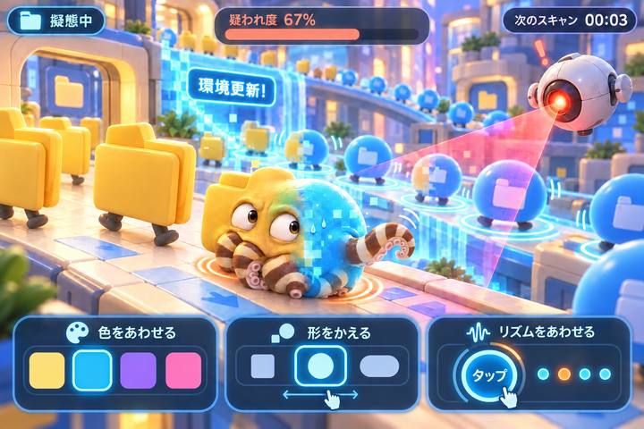

# アート方針 — かわいい3Dのデジタル擬態

## 方向を決めた画像

画像はアートの基準です。描かれた数値やテキストはUIの固定仕様ではありません。実装では3Dのタコ、データ群、ドローンがゲーム状態に応じて動きます。

## 必ず維持する特徴

| 対象 | 方針 |
| --- | --- |
| 主役 | クリームとココアの縞、8本の柔らかい腕、大きな目を持つオリジナルのミミックオクトパス |
| 擬態 | 体そのものが丸・四角・カプセルへ変わり、色も移り変わる |
| 空間 | 柔らかい立体感のあるデジタル広場。段差、奥行き、データの群れを配置 |
| 監視 | 丸くかわいいドローンと、危険が読み取れるスキャン光 |
| 基調色 | 暖かなクリームと黄、爽やかなシアン、補助の紫とピンク。操作部は読みやすい濃色 |

主役をカメレオンへ置き換えません。フォルダを着たタコにせず、柔らかい体を折り畳んだ結果として周囲の輪郭に近づくようにします。色だけ変わる普通のタコや、丸いマーカーだけで済ませないことが、このプロジェクトの見た目の最低条件です。

## タコの見え方

頭の輪郭がなめらかに変わり、腕が追いついて畳まれることで、擬態の途中だと分かるようにします。少しはみ出す腕、柔らかい吸盤、視線やまばたきで、タコらしさとかわいさを保ちます。

疑われ度が上がると目や姿勢に焦りが表れます。成功時には落ち着いた動きに戻ります。ゲームの読み取りを妨げない範囲で、表情と小さな動きを加えます。

## 3つの変化を視覚化する

| 変化 | 表現 | 整合性の確認 |
| --- | --- | --- |
| 色・形 | 環境更新の光の波、群れの新しい色と輪郭、タコの変形 | 周囲が示す正解とエンジンの目標が一致する |
| リズム | データのバウンド、足元の光、タコの周期的な動き | 周囲とタコがそれぞれの周期・拍の位置に従う |
| スキャン | ドローンの移動、視認できる光線、疑われ度と表情 | スキャン中かどうかと実際の判定が一致する |

リズムをランダムな装飾として動かさないでください。拍がずれているのに全員同じタイミングで跳ねると、遊びが成立しません。

## カメラとモバイル

固定した斜め上からのカメラを基本にし、主役の顔、変形する輪郭、近くの正常データを同時に見せます。タコを画面の中心付近で十分大きく描き、奥の装飾より優先します。

縦画面では主役、見本、ドローンを画面内へ収め、操作領域と重ならないように再配置します。横画面では空間の奥行きを使いながら、左右端へ重要な見本を追いやらないようにします。単にキャンバスを切り抜くだけで対応しないでください。

激しいカメラ揺れは避けます。動きを減らす設定でも、光や輪郭で更新と拍のタイミングが分かるようにします。

## 素材と実装

コンセプト画像はそのまま変形できる3D素材にはなりません。初期実装では実際のメッシュとアニメーションで必要な見た目を作り、後続でモデルや質感を磨きます。

優先順位は、タコの輪郭と腕、表情、群れとスキャン、柔らかい影と質感、背景の装飾です。端末の負荷を調整する際は、背景の密度や影の解像度から調整し、主役と擬態の読みやすさを保ちます。

外部のモデルやテクスチャを加える場合は、利用条件と出典を記録します。生成画像を静止したシーンとして敷くだけでは、このゲームの3D描画を実装したことにはなりません。

## 見た目の確認項目

- タコがクリームとココアの柔らかい生物として認識できる。
- 色・形・拍を変えると、実際に3Dの見た目と動きが変わる。
- 周囲の更新と迫る監視を、長い説明なしで読み取れる。
- 縦画面と横画面で顔、腕、見本、操作が隠れない。
- 疑われ度、判定、演出が矛盾しない。

最終的な視覚QAと実機での操作確認は、READMEに結果を記録してください。
