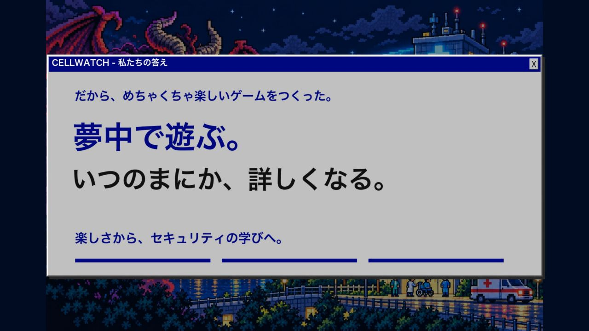

# CELLWATCH 発表用イントロ

情報漏えいの社会問題、私たちの知識の課題、夢中で遊ぶうちにセキュリティに詳しくなるゲームを作った理由から、夜間の病院への緊急着信へつなぐ30秒のイントロ動画です。

## ダウンロード

- [発表セットZIPをダウンロード](https://raw.githubusercontent.com/eightman999/DevDay-Community-Hackathon/master/presentation/cellwatch-presentation.zip)
- [30秒の動画を見る・ダウンロード](https://raw.githubusercontent.com/eightman999/DevDay-Community-Hackathon/master/presentation/cellwatch-intro-v6.mp4)
- [発表ページのHTML](index.html)

ZIPを展開し、`CELLWATCH_発表スタート.html`をブラウザで開いて「動画から紹介を始める」を押してください。
30秒の音付き動画が流れ、終了すると[公開ゲームの開始画面](https://cellwatch-inspection.eightman.chatgpt.site/)へ自動で切り替わります。ゲームのプレイは自動では開始しません。

HTMLには動画と背景を内蔵しています。APIキーは不要です。実ページの表示にはインターネット接続が必要です。
GitHub上のHTML表示はソースの閲覧用です。HTMLを保存して開くか、ZIP版をご利用ください。

## 構成

- 0〜約13秒：情報漏えいが社会問題に → 私たちの知識はまだ足りない → 遊びながら学べるゲームを作った。
- 約13〜25秒：病院からの電話 → 夜間の担当者としてシステムを守る。
- 25〜30秒：CELLWATCHのタイトル → 実ページへ。

指定のキーイメージとWindows風のUIを使用し、文字は読みやすい通常のゴシック体で描画しています。
ナレーションはOpenAI TTS（gpt-4o-mini-tts、cedar）によるAI生成音声です。
動画は1920×1080・24fps・H.264/AAC。公開日は2026-10-18、動画バージョンはv6です。
