# 26種のカタログ

各GLBは静止素材です。寸法・来歴・検証範囲は[README](README.md)と[CSV](models.csv)を参照してください。

| # | 地区 | モデル | GLB | 三角形 | プレビュー |
| --- | --- | --- | --- | ---: | --- |
| 1 | FS | 折り扇ポケットのフォルダ | [GLB](models/pcv_folder_fan_pocket.glb) | 1080 | 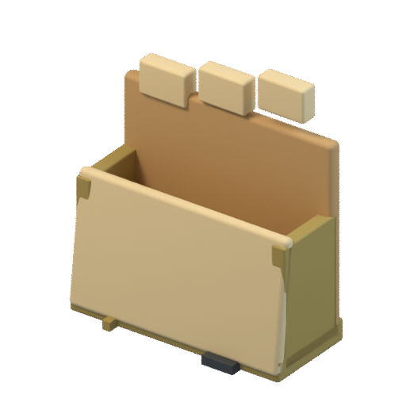 |
| 2 | FS | 留め具ZIPトランク | [GLB](models/pcv_zip_clasp_trunk.glb) | 1664 | 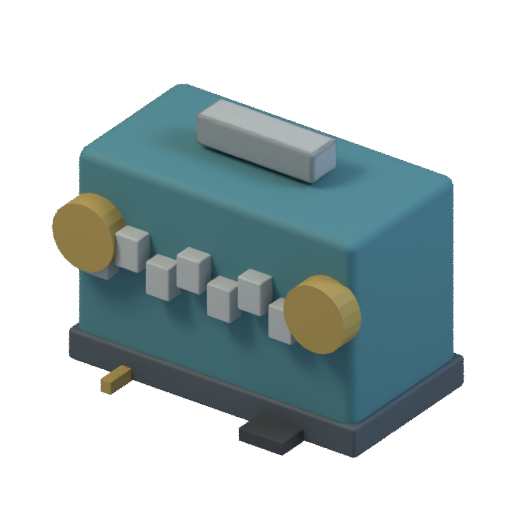 |
| 3 | FS | 花弁式ごみ箱 | [GLB](models/pcv_recycle_petal_bin.glb) | 1188 | 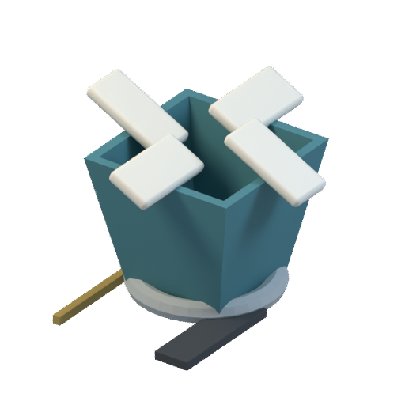 |
| 4 | FS | 歩いて隠れる棚 | [GLB](models/pcv_hide_walkin_shelf.glb) | 6568 | 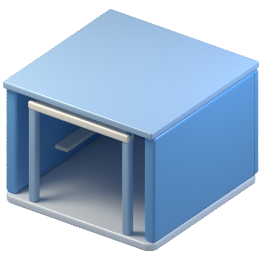 |
| 5 | SEC | 歩行用の検査門 | [GLB](models/pcv_walkthrough_checkpoint.glb) | 4188 | 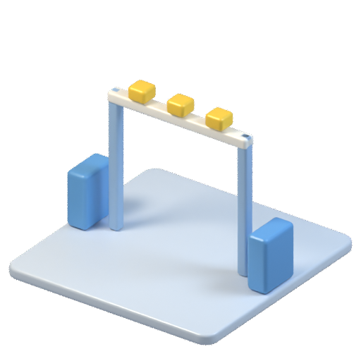 |
| 6 | TRASH | 回収口の曲り廊 | [GLB](models/pcv_trash_intake_corner.glb) | 3712 | 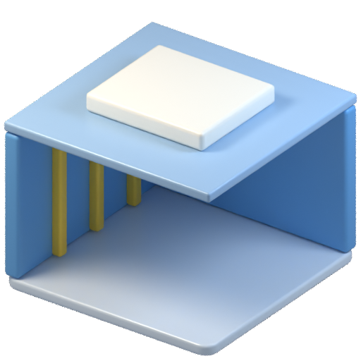 |
| 7 | FS | フォルダ門の小屋 | [GLB](models/pcv_folder_portal_house.glb) | 6092 | 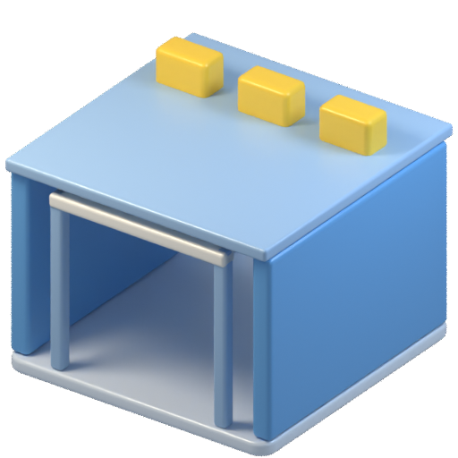 |
| 8 | SEC | 隔離の二重前室 | [GLB](models/pcv_quarantine_airlock_room.glb) | 5616 | 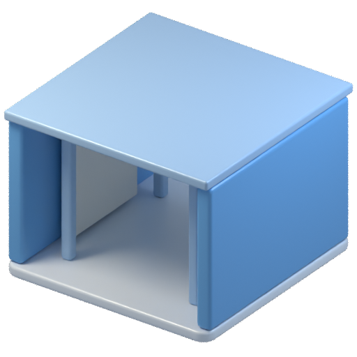 |
| 9 | TRASH | 削除データの回復室 | [GLB](models/pcv_deletion_recovery_vault.glb) | 7996 | 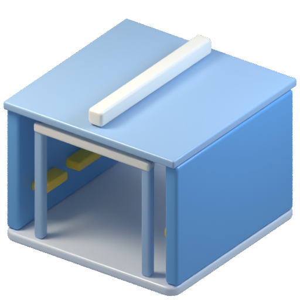 |
| 10 | FS | 表計算の三つ折りバインダー | [GLB](models/pcv_spreadsheet_grid_binder.glb) | 8848 | 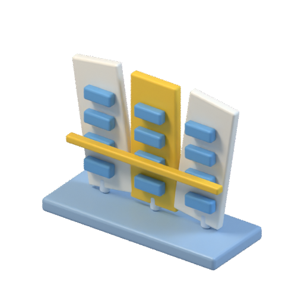 |
| 11 | FS | クリップボード転送クランプ | [GLB](models/pcv_clipboard_transfer_clamp.glb) | 3108 | 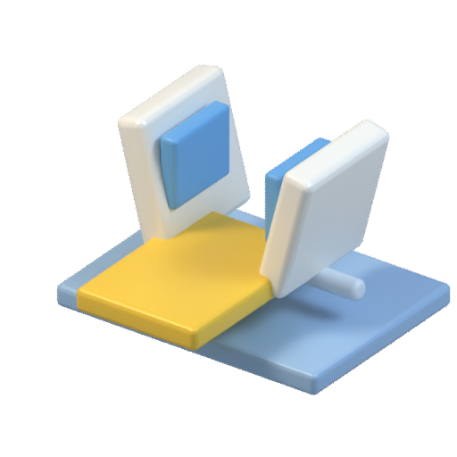 |
| 12 | SEC | 再起動チェックポイントのクランク | [GLB](models/pcv_reset_checkpoint_crank.glb) | 3456 | 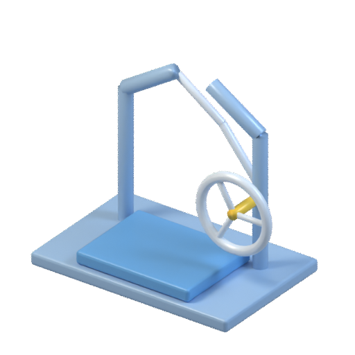 |
| 13 | TRASH | 宛先不明レターの回収かご | [GLB](models/pcv_deadletter_return_basket.glb) | 2036 | 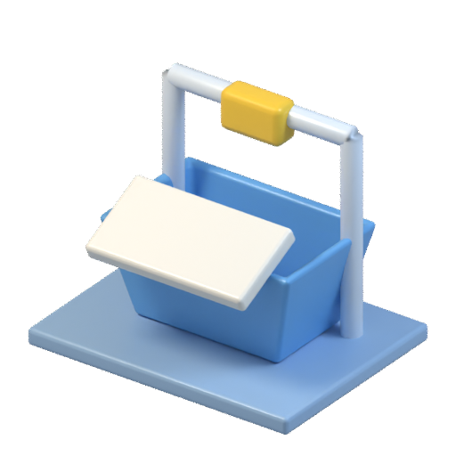 |
| 14 | TRASH | データ片の三叉すくい | [GLB](models/pcv_recovery_fragment_scoop.glb) | 5476 | 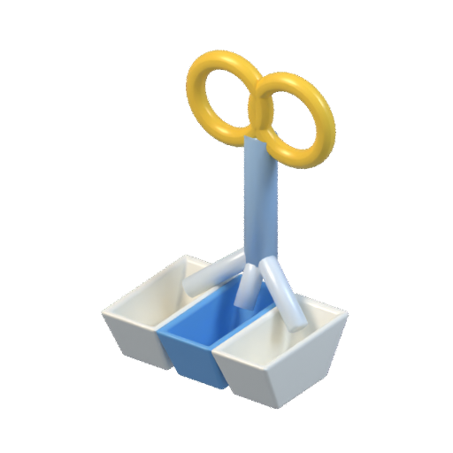 |
| 15 | CPU | 分割キー入力台 | [GLB](models/pcv_split_keyboard_keybed.glb) | 10532 | 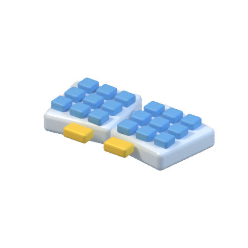 |
| 16 | CPU | 縦持ちポインターマウス | [GLB](models/pcv_vertical_mouse_cradle.glb) | 2088 | 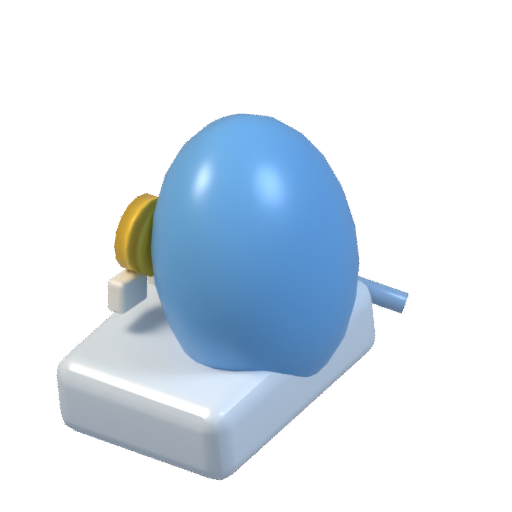 |
| 17 | CPU | トラックボールの手置き台 | [GLB](models/pcv_trackball_palm_socket.glb) | 4532 |  |
| 18 | CPU | 湾曲モニターの作業台 | [GLB](models/pcv_curved_monitor_shelter.glb) | 4416 | 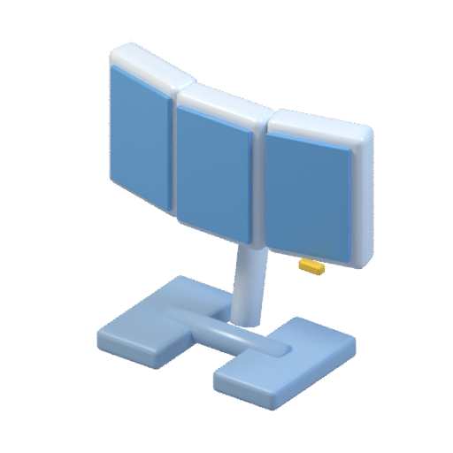 |
| 19 | NET | USBポートの丸型ハブ | [GLB](models/pcv_usb_port_puck_hub.glb) | 4048 | 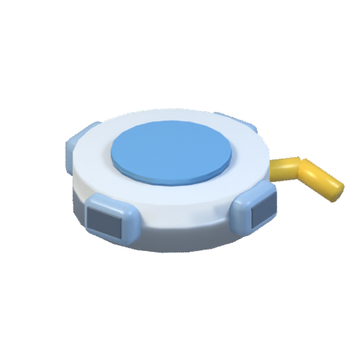 |
| 20 | RAM | ディスク像の断面プラッター | [GLB](models/pcv_disk_image_cutaway_platter.glb) | 980 |  |
| 21 | SEC | アクセスカードの読取台 | [GLB](models/pcv_access_card_reader_pedestal.glb) | 2644 | 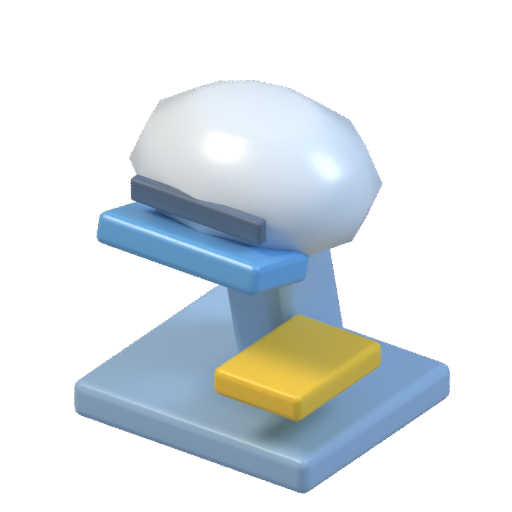 |
| 22 | FS | JSONの入れ子括弧箱 | [GLB](models/pcv_json_nested_bracebox.glb) | 2584 | 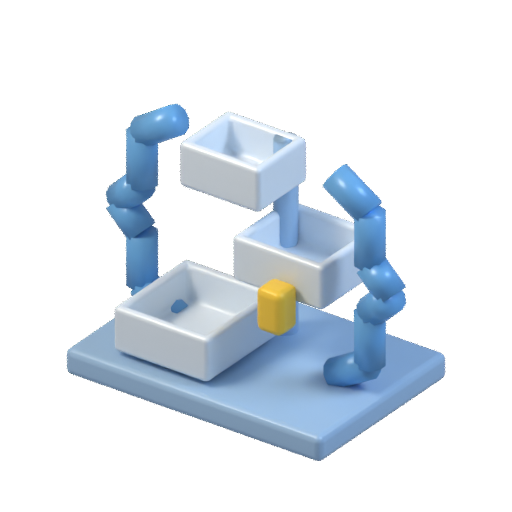 |
| 23 | SEC | パスキーの指先サドル | [GLB](models/pcv_passkey_touch_saddle.glb) | 1988 | 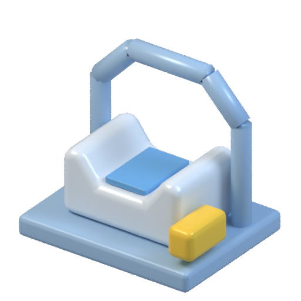 |
| 24 | TRASH | 不要データの掃き集め台 | [GLB](models/pcv_garbage_collection_sweeper.glb) | 1824 | 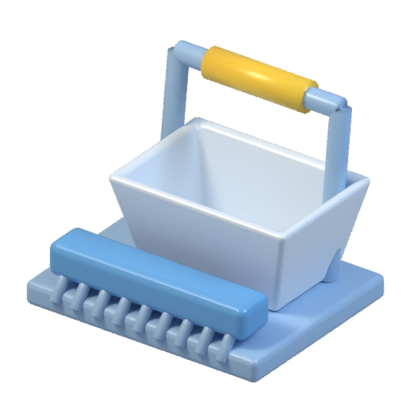 |
| 25 | TRASH | ジャーナル再生の展開ドラム | [GLB](models/pcv_journal_replay_drum.glb) | 18712 | 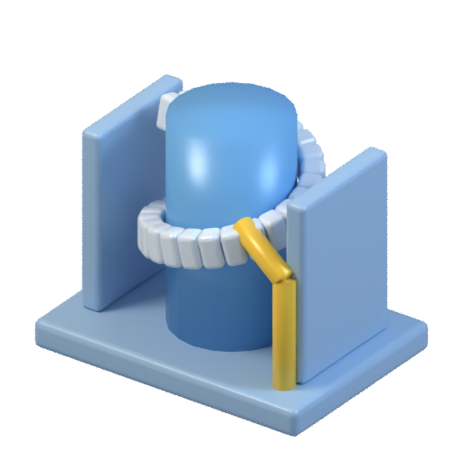 |
| 26 | RAM | 空き容量の浮子槽 | [GLB](models/pcv_storage_capacity_floatvessel.glb) | 3088 | 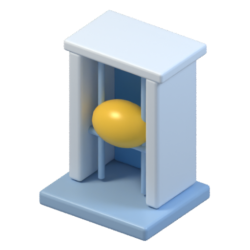 |
