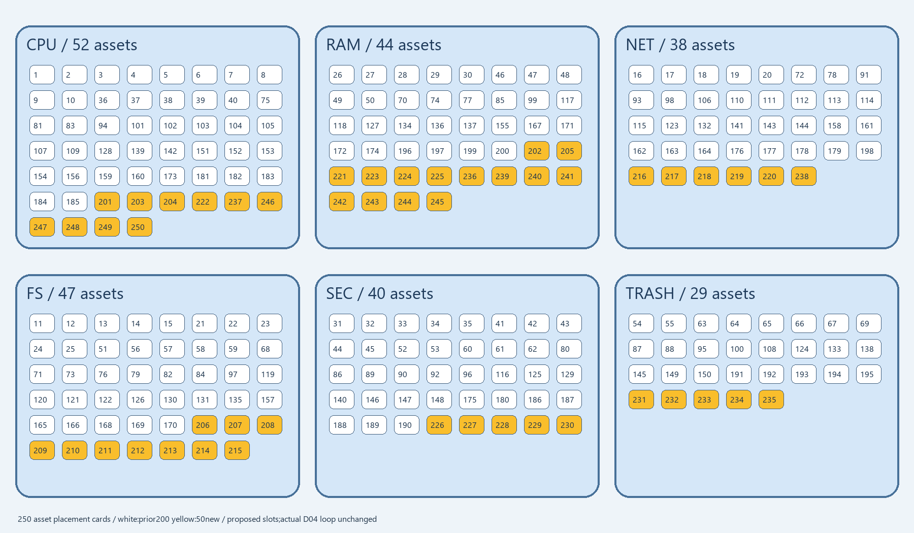

# CYBER 3Dの参考素材 — G07確定250種から26種

フォルダ・検問・回収設備・身近なPC小物を中心に、確定済みの独立26種を抜粋しました。**GLBは26本、合計3,953,448 bytes**です。同じモデルの色違い・配置違い・軽量用の結合版を別の種類として数えていません。各種1本の通常外観と既存プレビューを収録しています。

[モデル一覧と個別プレビュー](CATALOG.md) / [CSV](models.csv) / [由来・寸法・SHA-256](catalog.json) / [生成・利用説明](GENERATION.md)

六地区はCPU・FS・NET・RAM・SEC・TRASHです。[全250種の役割・配置計画CSV](all250-region-placement.csv)も添えています。**画像とCSVは地区ごとの仮配置計画であり、250種を接続した新しいプレイ可能ワールドではありません。** 地区内6 mスロットとD04で既に置かれた座標は別の列です。26種以外のモデルは収録していません。

制作記録の `CYBER_G07_HANDOFF.txt` と `cyber-g07-completion-status.json` に対応する確定250種のスナップショットを上限としています。元ZIP内の選択ファイルを当該スナップショットのSHA-256と照合しました。来歴が確認できない旧素材・未認証の露出状態・制作途中の後続バッチ・町1300種・RPG100種は含みません。本人の参照画像も同梱していません。[元アーカイブ名とハッシュ](source-archives.json)と[スナップショット概要](snapshot.json)を記録しています。個人Libraryの取得URLは掲載していません。

全て静止素材で、リグ・アニメーション・衝突・操作・ゲーム処理は含みません。制作時にBlenderで確認済みです。今回のGLB読込・再描画確認は[検証記録](blender-verification.json)、構造・画像・相対リンク・秘密情報検査は[共有検査](verification.json)に記録します。**Unity・スマホ実機・FPS・操作や物理は未検証**です。結合版はメッシュノード数を減らしたもので、実機での高速化を実証したものではありません。

**公開参考共有は本人承認済みです。新たなMIT・CC0等の配布ライセンスは付けていません。利用・再配布条件の確定は保留です。** 既存PRのThree.jsに付されたMIT表記を新素材へ自動適用しません。来歴説明や形状比較は権利・独自性を法的に保証するものではありません。制作日は2026-10-16以降の既存成果で、イベント参加条件は別途確認中です。適格性を断定しません。

[ファイルSHA-256](SHA256SUMS.txt) / [検査スクリプト](verify_references.py) / [音楽参考素材](../audio/README.md)
